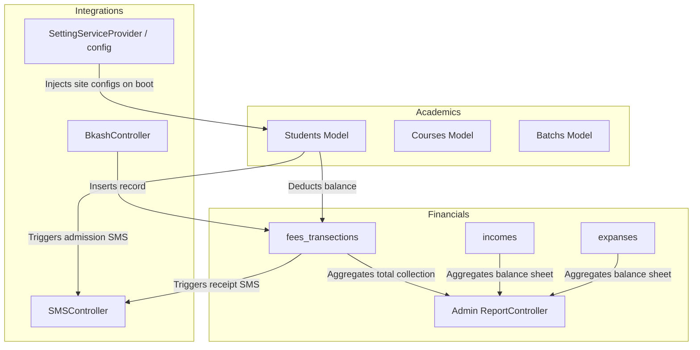

# 04. Route and Dependency Mapping

**Project:** `innova-web` (INNOVA Computers BD / ICBD)  
**Audit Date:** October 13, 2026  
**Auditor:** Antigravity Agentic Audit (Phase 0 Discovery)  
**Strict Constraint:** Read-Only Audit (No code/configuration/data changes made)

---

## 1. Route Architecture Overview

Total Registered Routes: **466 Routes** (verified via `php artisan route:list`).

### Breakdown by Route Group:
- **Administrative Routes (`prefix('admin')`, `auth:admin`):** 383 routes
- **Public Website Routes (`middleware('web')`):** 60 routes
- **Student User Portal (`prefix('user')`, `middleware('web')`):** 13 routes
- **Authentication Routes (`Auth::routes()`, `admin/login`):** 8 routes
- **Developer / Testing Routes (`/dev/*`):** 1 route
- **API Routes (`middleware('auth:api')`):** 1 route

---

## 2. Route → Middleware → Controller → Model → Table → View Mapping

### 2.1 Public Website & Marketing Subsystem
| Method | Route URI | Middleware | Controller & Method | Model(s) | Table(s) | View / Response |
|---|---|---|---|---|---|---|
| `GET` | `/` | `web` | `Frontend\FrontendController@index` | `Courses`, `Slider`, `Review`, `Teachers` | `courses`, `sliders`, `reviews`, `teachers` | `frontend.home` |
| `GET` | `/about` | `web` | `Frontend\FrontendController@about` | `cmsAbout`, `Teachers` | `cms_abouts`, `teachers` | `frontend.modules.about` |
| `GET` | `/courses` | `web` | `Frontend\FrontendController@courses` | `Courses`, `CourseCategory` | `courses`, `course_categories` | `frontend.modules.courses` |
| `GET` | `/courses/{id}` | `web` | `Frontend\FrontendController@CoursesByCategory` | `Courses`, `CourseCategory` | `courses`, `course_categories` | `frontend.modules.courses` |
| `GET` | `/course-details/{id}` | `web` | `Frontend\FrontendController@courseDetails` | `Courses`, `Batchs` | `courses`, `batchs` | `frontend.modules.course_details` |
| `GET` | `/{id}/admission` | `web` | `Frontend\FrontendController@courseAdmission` | `Courses`, `Batchs`, `Branch` | `courses`, `batchs`, `branches` | `frontend.modules.admission` |
| `POST` | `/admissions` | `web` | `Frontend\FrontendController@storeAdmission` | `Admission` | `admissions` | Redirect with success flash |
| `GET` | `/seminors` | `web` | `Frontend\FrontendController@Seminors` | `Seminor` | `seminors` | `frontend.modules.seminors` |
| `GET` | `/seminorsreg/{id}` | `web` | `Frontend\FrontendController@SeminorsReg` | `Seminor` | `seminors` | `frontend.modules.seminors_reg` |
| `POST` | `/seminorsregstration` | `web` | `Frontend\FrontendController@SeminorsRegStore` | `SeminorRegistration` | `seminor_registrations` | Redirect with success flash |
| `GET` | `/blogs` | `web` | `Frontend\FrontendController@blogs` | `Blog`, `blogCategoris` | `blogs`, `blog_categoris` | `frontend.modules.blogs` |
| `GET` | `/blogs/{id}` | `web` | `Frontend\FrontendController@blogsShow` | `Blog` | `blogs` | `frontend.modules.blog_details` |
| `POST` | `/searchblog` | `web` | `Frontend\FrontendController@search` | `Blog` | `blogs` | `frontend.modules.blogs` |
| `GET` | `/gallery` | `web` | `Frontend\FrontendController@gallery` | `Gallery` | `galleries` | `frontend.modules.gallery` |
| `GET` | `/successstory` | `web` | `Frontend\FrontendController@successStory` | `SuccessStory` | `success_stories` | `frontend.modules.success_story` |
| `GET` | `/instructors` | `web` | `Frontend\FrontendController@instructors` | `Teachers` | `teachers` | `frontend.modules.instructors` |
| `GET` | `/contact` | `web` | `Frontend\FrontendController@contact` | N/A | N/A | `frontend.modules.contact` |
| `POST` | `/contact` | `web` | `Frontend\FrontendController@storeContact` | `Contact` | `contacts` | Redirect with flash |
| `GET` | `/certifiocate-verify/{slnum}` | `web` | `Frontend\FrontendController@certificateVerify` | `Certificate_icbd` | `certificate_icbds` | `frontend.modules.certificate_verify` |
| `GET` | `/certifiocate-verify-bteb` | `web` | `Frontend\FrontendController@certificateVerifyForm` | N/A | N/A | `frontend.modules.bteb_verify` |
| `POST` | `/certifiocate-verify-bteb` | `web` | `Frontend\FrontendController@certificateVerifyCheck` | `Certificates` | `certificates` | `frontend.modules.bteb_verify` |
| `GET` | `/asset-registration` | `web` | `Frontend\AssetController@index` | `AssetCourse` | `asset_courses` | `frontend.v2.asset.index` |
| `POST` | `/asset-registration-submit` | `web` | `Frontend\AssetController@store` | `AssetRegistration` | `asset_registrations` | Redirect with flash |
| `GET` | `/services` | `web` | `FrontendServiceController@index` | `Service` | `services` | `frontend.modules.services` |
| `GET` | `/products` | `web` | `FrontendProductController@index` | `Product` | `products` | `frontend.modules.products` |
| `GET` | `/concerns` | `web` | `FrontendConcernController@index` | `Concern` | `concerns` | `frontend.modules.concerns` |
| `GET` | `/workflow` | `web` | `FrontendWorkflowController@index` | `Workflow` | `workflows` | `frontend.modules.workflow` |

### 2.2 Student User Portal & bKash Payment Routes
| Method | Route URI | Middleware | Controller & Method | Model(s) | Table(s) | View / Response |
|---|---|---|---|---|---|---|
| `GET` | `/user/dashboard` | `web`, `auth` | `UserController@index` | `Students`, `Courses`, `Batchs` | `students`, `courses`, `batchs` | `users.dashboard` |
| `GET` | `/user/profile` | `web`, `auth` | `UserController@profile` | `Students` | `students` | `users.profile.index` |
| `GET` | `/user/payment-history`| `web`, `auth` | `UserController@paymentHistory` | `Students`, `FeesTransections` | `students`, `fees_transections` | `users.profile.payments-history` |
| `GET` | `/pay` | `web` | `BkashController@pay` | N/A | N/A | `Iframe.pay` (commented out) |
| `GET` | `/user/bkash/create` | `web` | `BkashController@create` | N/A (Session) | N/A | JSON response (bKash create) |
| `GET` | `/user/bkash/execute`| `web` | `BkashController@execute`| N/A (Session) | N/A | JSON response (bKash execute) |
| `GET` | `/user/success` | `web` | `BkashController@success`| `FeesTransections` | `fees_transections` | `users.profile.success` |
| `GET` | `/user/fail` | `web` | `BkashController@fail` | N/A (Session) | N/A | `users.profile.fail` |
| `GET` | `/user/bkash/search` | `web` | `BkashController@search` | N/A | N/A | `users.profile.search-transaction` |
| `GET` | `/user/bkash/search-transaction` | `web` | `BkashController@searchTransaction` | N/A (API) | N/A | JSON response |

### 2.3 Core Administrative Subsystem (`middleware('auth:admin')`)
| Method | Route URI Pattern | Action Controller | Underlying Model(s) | Database Tables | Notes / Vulnerability |
|---|---|---|---|---|---|
| `GET|POST` | `/admin/students/*` | `Admin\StudentsController` | `Students`, `Courses`, `Batchs` | `students`, `courses`, `batchs`, `branches` | Manual `$sid + 1` ID generation; deletion via POST |
| `GET|POST` | `/admin/fees/*` | `Admin\FeesTransectionsController` | `FeesTransections`, `Students` | `fees_transections`, `students` | Cash fee entry, balance deduction, SMS dispatch |
| `GET|POST` | `/admin/courses/*` | `Admin\CoursesController` | `Courses`, `CourseCategory` | `courses`, `course_categories` | Curriculum module management |
| `GET|POST` | `/admin/batchs/*` | `Admin\BatchsController` | `Batchs` | `batchs` | Weekly schedule & slot timings |
| `GET|POST` | `/admin/session/*` | `Admin\SessionController` | `Session` | `sessions` | Academic calendar batches |
| `GET|POST` | `/admin/teachers/*` | `Admin\TeachersController` | `Teachers` | `teachers` | Instructor directory |
| `GET|POST` | `/admin/branch/*` | `Admin\BranchController` | `Branch` | `branches` | Physical branch offices |
| `GET|POST` | `/admin/expance/*` | `Admin\ExpanseController` | `Expanse`, `ExpanseCategoris` | `expanses`, `expanse_categoris` | Money amount as VARCHAR |
| `GET|POST` | `/admin/income/*` | `Admin\IncomeController` | `Income`, `IncomeCategoris` | `incomes`, `income_categoris` | Money amount as VARCHAR |
| `GET` | `/admin/reports/*` | `Admin\ReportController` | `Expanse`, `Income`, `Students`| `expanses`, `incomes`, `students` | `DB::raw('REPLACE(amount, ",", ""))` |
| `GET|POST` | `/admin/shareholder/*`| `Admin\ShareholderController` | `Shareholder` | `shareholders` | Capital share percentage |
| `GET|POST` | `/admin/investment/*` | `Admin\InvesmentsController` | `Invesments` | `invesments` | Capital deposits |
| `GET|POST` | `/admin/investment/withdraw/*` | `Admin\InvestmentWithdrawController` | `InvestmentWithdraw` | `investment_withdraws` | **Missing migration file** |
| `GET|POST` | `/admin/dividend/withdraw/*` | `Admin\DividendWithdrawController` | `DividendWithdraw` | `dividend_withdraws` | **Missing migration file** |
| `GET|POST` | `/admin/bank-loans/*` | `Admin\BankLoanController` | `BankLoan` | `bank_loans` | **Missing migration file** |
| `GET|POST` | `/admin/emi-installments/*` | `Admin\EmiInstallmentController` | `EmiInstallment` | `emi_installments` | **Missing migration file** |
| `GET|POST` | `/admin/assets/*` | `Admin\AssetController` | `AssetRegistration`, `AssetRegistrationFeedback` | `asset_registrations`, `asset_registration_feedbacks` | ASSET call follow-up notes |
| `GET|POST` | `/admin/asset-training/*` | `Admin\CourseController`, `Admin\StudentManagementController` | `AssetCourse`, `AssetStudent` | `asset_courses`, `asset_students` | ASSET course outline & trainee files |
| `GET|POST` | `/admin/certificate/*`| `Admin\CertificateController` | `Certificates` | `certificates` | BTEB certificates |
| `GET|POST` | `/admin/certificate_icbd/*`| `Admin\CertificateICBDController`| `Certificate_icbd` | `certificate_icbds` | Internal certificates (**Missing migration**) |
| `GET|POST` | `/admin/sms/*` | `Admin\SMSController` | `Students` | `students` | Class postpone & batch SMS |
| `GET|POST` | `/admin/settings` | `Admin\SettingController` | `Setting` | `settings` | Logo upload bug skips settings |
| `GET|POST|DELETE` | `/admin/roles/*` | `Admin\RoleController` | Spatie `Role`, `Permission` | `roles`, `permissions` | Only controller enforcing Spatie middleware |
| `GET|POST` | `/admin/admins/*` | `Admin\UserController` | `Admin` | `admins` | Administrative user accounts |

---

## 3. Dangerous Routes & State-Changing GET Operations

### 3.1 State-Changing GET Artisan Endpoints in `routes/admin.php`
The following routes trigger server-state mutations via simple `GET` requests without CSRF protection:
1. `GET /admin/storagelink` → Runs `Artisan::call('storage:link')`.
2. `GET /admin/optimize` → Runs `Artisan::call('optimize:clear')`.
3. `GET /admin/configcatche` → Runs `Artisan::call('config:cache')`. **(Breaks bKash & SMS by turning direct env() calls to null!)**
4. `GET /admin/configclear` → Runs `Artisan::call('config:clear')`.
5. `GET /admin/viewclear` → Runs `Artisan::call('view:clear')`.
6. `GET /admin/cacheclear` → Runs `Artisan::call('cache:clear')`.
7. `GET /admin/vendorpublish` → Runs `Artisan::call('vendor:publish ...')`.

### 3.2 Orphan Deletion Routes in `app/Http/Controllers/Admin/admin.php`
The stray route file left in the controller directory defines state-changing record deletions over `GET`:
- `GET /admin/courses/{id}/delete`
- `GET /admin/batchs/{id}/delete`
- `GET /admin/students/{id}/delete`
- `GET /admin/session/{id}/delete`

### 3.3 Payment Callback Flow
- `GET /user/success` (`BkashController@success`):
  - Does NOT verify transaction validity against bKash REST API.
  - Relies solely on session array (`Session::get('arr')`).
  - Lacks idempotency check: refreshing or re-visiting this GET route will attempt to insert duplicate rows into `fees_transections` or throw an exception.

---

## 4. Cross-Module Dependencies & Shared Business Logic

### Shared Logic Tight-Coupling:
1. **Student Balance Calculation:**
   - Modified by manual cash entry in [`FeesTransectionsController@store`](file:///c:/wamp64/www/innova-web/app/Http/Controllers/Admin/FeesTransectionsController.php).
   - Modified by bKash execution in [`BkashController@success`](file:///c:/wamp64/www/innova-web/app/Http/Controllers/BkashController.php).
   - Initialized in [`StudentsController@store`](file:///c:/wamp64/www/innova-web/app/Http/Controllers/Admin/StudentsController.php).
2. **Global Setting Hydration:**
   - [`SettingServiceProvider`](file:///c:/wamp64/www/innova-web/app/Providers/SettingServiceProvider.php) queries `settings` table on every non-console web request and overrides `config('settings.*')`.
3. **SMS Dispatch Coupling:**
   - Admission store in `StudentsController` directly constructs and dispatches Bengali SMS.
   - Fee transaction store in `FeesTransectionsController` directly dispatches receipt SMS.
