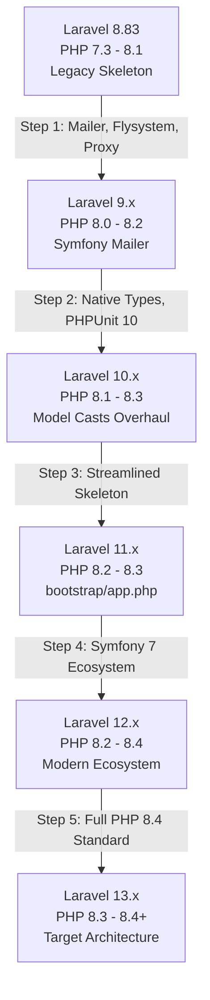

# 04. Laravel 13 Framework Upgrade Risks and Architectural Analysis

**Project:** `innova-web` (INNOVA Computers BD / ICBD)  
**Existing Framework:** Laravel Framework `v8.83.29`  
**Target Framework:** Laravel `13.x`  
**Audit Date:** October 2026  
**Status:** Read-Only Audit (Phase 0)  
**Auditor:** Senior Laravel Migration Architect  

---

## 1. Executive Summary

Upgrading from **Laravel 8** directly to **Laravel 13** spans **five major framework generations** across six years of architectural evolution. During this span, Laravel fundamentally overhauled its directory skeleton, routing architecture, configuration loading, mail subsystem, proxy handling, exception reporting, and model casting.

Attempting a **direct jump** from Laravel 8 to Laravel 13 without executing the sequential migration steps or without adopting a clean-slate skeleton re-platforming will result in catastrophic failure of Composer dependency resolution, broken route dispatching, silent middleware bypass, and unhandled runtime exceptions.

---

## 2. Multi-Version Architectural Evolution (Laravel 8 to 13)



### 2.1 Major Breaking Changes by Framework Generation

| Version Step | Key Framework Breaking Changes | Impact on `innova-web` | Severity |
|---|---|---|---|
| **Laravel 8 → 9** | • SwiftMailer replaced by Symfony Mailer<br/>• Flysystem v1 upgraded to Flysystem v3<br/>• `fideloper/proxy` merged into core<br/>• `lang` directory moved to root<br/>• Default password hashing work factor increased | • `config/mail.php` driver syntax broken<br/>• `app/Http/Middleware/TrustProxies.php` broken<br/>• Storage filesystem drivers need verification | **Critical** |
| **Laravel 9 → 10** | • PHP 8.1 minimum requirement<br/>• Eloquent `$dates` property removed<br/>• Native return and parameter types added to skeleton<br/>• `dispatchNow()` removed in favor of `dispatchSync()`<br/>• PHPUnit 9 upgraded to PHPUnit 10 | • 10 Eloquent models using `$dates` broken<br/>• Stubs and overrides need type matching<br/>• `phpunit.xml` schema invalidated | **High** |
| **Laravel 10 → 11** | • PHP 8.2 minimum requirement<br/>• **Skeleton Simplification:**<br/>  - `app/Http/Kernel.php` removed<br/>  - `app/Console/Kernel.php` removed<br/>  - `app/Exceptions/Handler.php` removed<br/>  - `RouteServiceProvider`, `AuthServiceProvider`, `EventServiceProvider` removed<br/>• Native model `casts()` method introduced<br/>• SQLite 3.35.0+ and PostgreSQL 12+ minimums | • All 466 routes registered with string controller actions fail without explicit namespace binding<br/>• Custom exception handler logic in `Handler.php` lost if not ported to `bootstrap/app.php`<br/>• Global middleware in `Kernel.php` ignored | **Critical** |
| **Laravel 11 → 12** | • Symfony 7.x component standardization<br/>• Deprecated Laravel 10/11 features removed<br/>• Enhanced attribute-based routing & events | • Third-party packages must declare L12 support | **Medium** |
| **Laravel 12 → 13** | • PHP 8.3/8.4 minimum requirement<br/>• Strict type enforcement and modern PHP 8.4 attributes<br/>• Deprecations from Laravel 12 removed | • Full ecosystem alignment required | **High** |

---

## 3. High-Risk Framework Subsystems in `innova-web`

### 3.1 Routing Architecture and Controller Resolution
- **Finding ID:** LAR-01
- **Severity:** Critical
- **Files Affected:** [`routes/web.php`](file:///c:/wamp64/www/innova-web/routes/web.php), [`routes/admin.php`](file:///c:/wamp64/www/innova-web/routes/admin.php), [`app/Providers/RouteServiceProvider.php`](file:///c:/wamp64/www/innova-web/app/Providers/RouteServiceProvider.php)
- **Observed Code:**
  ```php
  // In RouteServiceProvider.php:
  protected $namespace = 'App\Http\Controllers';
  ...
  Route::middleware('web')->namespace($this->namespace)->group(base_path('routes/web.php'));

  // In routes/web.php & routes/admin.php:
  Route::get('/', 'Frontend\FrontendController@index')->name('frontend.home');
  Route::get('settings', 'Admin\SettingController@index')->name('admin.settings');
  ```
- **Why It Matters:** 
  1. In Laravel 11/12/13, `RouteServiceProvider` has been eliminated. Routes are loaded via `bootstrap/app.php`:
     ```php
     ->withRouting(
         web: __DIR__.'/../routes/web.php',
         commands: __DIR__.'/../routes/console.php',
     )
     ```
  2. By default, modern Laravel does NOT prefix routes with `'App\Http\Controllers'`. All 466 routes using string action syntax (`'Admin\StudentsController@index'`) will throw `Target class [Admin\StudentsController] does not exist`!
- **Recommended Action:** Either configure root namespace in `bootstrap/app.php` or systematically convert routes to tuple callable syntax (`[StudentsController::class, 'index']`).

---

### 3.2 Exception Handling Modernization
- **Finding ID:** LAR-02
- **Severity:** High
- **File Affected:** [`app/Exceptions/Handler.php:53-82`](file:///c:/wamp64/www/innova-web/app/Exceptions/Handler.php#L53-L82)
- **Observed Behavior:**
  1. Custom rendering for Spatie `UnauthorizedException`:
     ```php
     if ($exception instanceof \Spatie\Permission\Exceptions\UnauthorizedException) {
         return response()->json(['User have not permission for this page access.']);
     }
     ```
  2. Custom guard-based unauthenticated redirection:
     ```php
     protected function unauthenticated($request, AuthenticationException $exception) {
         ...
         $guard = Arr::get($exception->guards(), 0);
         switch($guard){
             case 'admin': $login = 'admin.login'; break;
             default: $login = 'auth.login'; break; // BUG: auth.login route does not exist!
         }
         return redirect()->guest(route($login));
     }
     ```
- **Why It Matters:** In Laravel 11/12/13, `app/Exceptions/Handler.php` is deprecated/removed. Exception customization is configured in `bootstrap/app.php`:
  ```php
  ->withExceptions(function (Exceptions $exceptions) {
      $exceptions->render(function (\Spatie\Permission\Exceptions\UnauthorizedException $e, $request) {
          return $request->expectsJson() 
              ? response()->json(['message' => 'Unauthorized'], 403)
              : abort(403);
      });
  })
  ```
  Furthermore, the bug on line 78 (`$login = 'auth.login'`) must be fixed to `'login'`.
- **Verification Status:** Confirmed.

---

### 3.3 Middleware Stack Migration
- **Finding ID:** LAR-03
- **Severity:** High
- **Files Affected:** [`app/Http/Kernel.php`](file:///c:/wamp64/www/innova-web/app/Http/Kernel.php), [`app/Http/Middleware/`](file:///c:/wamp64/www/innova-web/app/Http/Middleware/)
- **Observed Behavior:** The project defines custom middleware aliases and global middleware in `Kernel.php`:
  - `role` => `\Spatie\Permission\Middlewares\RoleMiddleware::class`
  - `permission` => `\Spatie\Permission\Middlewares\PermissionMiddleware::class`
  - `CheckForMaintenanceMode`
  - `TrustProxies`
- **Why It Matters:** In Laravel 11/12/13, `app/Http/Kernel.php` is removed. All global middleware, middleware groups (`web`, `api`), and route middleware aliases must be registered in `bootstrap/app.php` via `->withMiddleware(function (Middleware $middleware) { ... })`.
- **Verification Status:** Confirmed.

---

### 3.4 Academic Sessions Table vs. Laravel Database Session Driver Collision
- **Finding ID:** LAR-04
- **Severity:** Critical
- **Files Affected:**
  - [`database/migrations/2022_08_19_163812_create_sessions_table.php`](file:///c:/wamp64/www/innova-web/database/migrations/2022_08_19_163812_create_sessions_table.php)
  - [`database/migrations/2024_07_13_012857_create_sessions_table.php`](file:///c:/wamp64/www/innova-web/database/migrations/2024_07_13_012857_create_sessions_table.php)
  - [`config/session.php`](file:///c:/wamp64/www/innova-web/config/session.php)
  - [`app/Models/Session.php`](file:///c:/wamp64/www/innova-web/app/Models/Session.php)
- **Observed Behavior:**
  1. The business domain uses a table named `sessions` for **academic calendar sessions** (`sessionName`, `startdate`, `enddate`, `IsActive`).
  2. In 2024, two migration files were generated for Laravel HTTP session persistence, also targeting table `sessions` (`id`, `user_id`, `ip_address`, `payload`, `last_activity`).
  3. If `SESSION_DRIVER=database` is configured in `.env`, Laravel will overwrite or collide with the academic session table.
- **Why It Matters:** Running migrations causes immediate schema collision and data loss for academic course sessions.
- **Recommended Action:**
  1. Rename the academic sessions table and model to `academic_sessions` (`AcademicSession.php`).
  2. Reserve the `sessions` table exclusively for Laravel's session driver, or configure Redis as the session driver (`SESSION_DRIVER=redis`).
- **Verification Status:** Confirmed.

---

### 3.5 Absence of Automated Regression Tests
- **Finding ID:** LAR-05
- **Severity:** Critical
- **Directory Affected:** [`tests/`](file:///c:/wamp64/www/innova-web/tests/)
- **Observed Behavior:** The test suite contains only default skeleton files (`tests/Feature/ExampleTest.php` and `tests/Unit/ExampleTest.php`). There are **zero application unit or integration tests**.
- **Why It Matters:** Without automated regression tests, performing an upgrade across 5 major Laravel versions carries a 100% risk of undetected failures in student billing, bKash verification, report generation, and SMS dispatches.
- **Recommended Action:** Prior to running Composer upgrades, implement a baseline suite of HTTP smoke tests covering authentication, student creation, fee payment, and report queries.
- **Verification Status:** Confirmed.

---

## 4. Upgrade Strategy Evaluation: In-Place Step Upgrade vs. Clean Skeleton Re-Platforming

Two viable strategies exist for reaching Laravel 13:

| Dimension | Strategy A: Step-by-Step In-Place Upgrade (8 → 9 → 10 → 11 → 12 → 13) | Strategy B: Clean Skeleton Re-Platforming (Recommended) |
|---|---|---|
| **Approach** | Update `composer.json` incrementally through each major version, running Composer update and resolving conflicts at each stage. | Create a clean Laravel 13 application with the modern skeleton, then port models, repositories, business logic, and routes. |
| **Dependency Complexity** | **Extreme:** Resolving Composer version locks across 5 intermediate versions requires hours of manual constraint tweaking. | **Minimal:** Start with clean, modern, fully compatible Laravel 13 dependencies from day one. |
| **Directory Hygiene** | **Poor:** Retains legacy shared-hosting cruft (`index.php`, dual asset folders, deprecated middleware classes). | **Pristine:** Guarantees strict modern Laravel directory structure without obsolete files. |
| **Risk of Ghost Deprecations** | **High:** Residual files in `app/Http/Kernel.php` or `app/Exceptions/` may cause subtle routing or error handling bugs. | **Zero:** Framework stubs are guaranteed modern. |
| **Effort Estimate** | 40–60 hours of sequential debugging | 25–35 hours of clean porting and test-driven validation |

### Recommendation
**Strategy B (Clean Skeleton Re-Platforming to Laravel 13)** is strongly recommended. It completely bypasses intermediate dependency conflicts while cleanly excising the shared-hosting anomalies present in the current repository.
