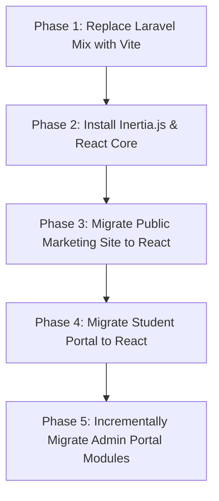

# 06. Frontend Architecture and React Migration Strategy

**Project:** `innova-web` (INNOVA Computers BD / ICBD)  
**Current Frontend:** Blade Views (326 files) + Bootstrap 4 + jQuery + Unused Vue 2 Scaffolding  
**Current Asset Tooling:** Laravel Mix 4.0.7 (Webpack 4)  
**Target Frontend:** Modern React (18+ / 19) + Vite + Tailwind CSS  
**Audit Date:** October 2026  
**Status:** Read-Only Audit (Phase 0) — No frontend files converted  
**Auditor:** Senior Frontend Architect & Laravel Fullstack Specialist  

---

## 1. Executive Summary

A comprehensive frontend inspection reveals a major misconception in the project's reported tech stack: **Vue.js is NOT actually used in the application UI**. Although `vue: ^2.5.17` and `laravel-mix: ^4.0.7` are declared in `package.json`, they are merely leftover boilerplate from `laravel/ui`. In the entire repository, only a single dummy component (`ExampleComponent.vue`) exists, and it is never mounted in any business view.

The actual existing frontend consists of **326 server-rendered Blade templates** tightly coupled to **Bootstrap 4.1.0, jQuery 3.2, DataTables, Select2, and inline JavaScript**.

Because `routes/api.php` contains zero business endpoints, transitioning to React cannot be achieved simply by "converting Vue components." Two distinct architectural paths exist for the React migration:
1. **Inertia.js + React (Recommended Monorepo Architecture):** Retains Laravel's routing, controllers, authentication guards, and middleware, while replacing Blade templates with modern React components.
2. **Decoupled SPA (React / Next.js + Laravel Sanctum REST API):** Requires rewriting all 76 controllers into JSON API endpoints, implementing token authentication, and managing separate deployments.

---

## 2. Existing Frontend Inventory and Dependency Analysis

### 2.1 Package Tooling Inventory (`package.json`)

| Dependency | Declared Version | Actual Usage in Codebase | Security & EOL Status | Target Replacement |
|---|---|---|---|---|
| `vue` | `^2.5.17` | **Zero UI Usage.** Only present in `ExampleComponent.vue`. | **EOL:** Reached End-of-Life Dec 31, 2023. | Discard; adopt React 18/19. |
| `laravel-mix` | `^4.0.7` | Compiles `resources/sass/app.scss` and `resources/js/app.js`. | **Obsolete:** Webpack 4 wrapper; fails on modern Node LTS without legacy crypto flags. | Vite `^5.4` / `^6.0` (`@laravel/vite-plugin`). |
| `bootstrap` | `^4.1.0` | Primary CSS grid, modals, navbar, tables across all 326 views. | **Superseded:** Bootstrap 4 is obsolete. | Tailwind CSS + Headless UI / Shadcn. |
| `jquery` | `^3.2` | DOM manipulation, Ajax requests, DataTables, Select2 plugins. | **Legacy:** Anti-pattern in modern React applications. | Native React state & component libraries. |
| `cross-env` | `^5.1` | Mix scripts in `package.json`. | **Deprecated:** Repository archived. | Vite native environment handling. |
| `axios` | `^0.19` | Basic Ajax setup in `resources/js/bootstrap.js`. | Outdated (`CVE-2020-28168`, `CVE-2021-3749`). | Modern `axios: ^1.7` or native `fetch`. |

### 2.2 Security Vulnerabilities in NPM Dependencies
Running `npm audit` against `package-lock.json` reveals **99 known vulnerabilities** (26 High Severity), primarily originating from obsolete transitive dependencies in Webpack 4, `lodash: 4.17.13`, and `resolve-url-loader: 2.3.1`.

---

## 3. Template and View Architecture Audit

The repository contains **326 Blade view files** categorized into four distinct UI sections:

```
resources/views/
├── admin/          (242 views)  <-- Admin portal: students, batches, reports, loans, settings
├── frontend/       (48 views)   <-- Public marketing website: home, courses, seminars, blogs
├── users/          (24 views)   <-- Student portal: profile, payment history, registration
├── layouts/        (1 view)     <-- Legacy auth layout (app.blade.php)
└── vendor/         (11 views)   <-- Pagination, DomPDF, and LFM templates
```

### Key UI Architecture Discoveries:
1. **Shared Hosting Path Workarounds:** Blade layouts use hardcoded asset paths like `{{ asset('public/storage/...') }}` and `{{ asset('backend/vendor/fontawesome-free/css/all.min.css') }}`. These path prefixes must be cleaned up to standard Vite asset aliases (`@/assets/...`).
2. **Third-Party CDN Dependencies:** Core libraries (DataTables 1.13.6, SweetAlert2 11, Magnific Popup 1.1.0, Google Fonts) are loaded directly via external CDN `<link>` and `<script>` tags in `resources/views/admin/app.blade.php`.
3. **Heavy Inline JavaScript:** Admin views contain thousands of lines of inline `<script>` blocks executing jQuery Ajax calls, dynamic table population, and form calculations (e.g., student fee balance deductions).

---

## 4. The Two React Migration Architectural Pathways

Because the application currently lacks an API layer, migrating to React requires selecting an architectural paradigm before writing code:

### Pathway Comparison Matrix

| Evaluation Dimension | Option A: Inertia.js + React (Recommended) | Option B: Decoupled SPA (React + REST API) |
|---|---|---|
| **Architecture** | Monolithic Laravel backend serving React components via Inertia protocol. | Separate React SPA (Vite/Next.js) consuming a headless Laravel REST API. |
| **Backend Impact** | **Minimal:** Keep 466 routes, session auth, CSRF protection, and controllers. Change `return view('admin.students.index', $data)` to `return Inertia::render('Admin/Students/Index', $data)`. | **Massive:** Rewrite 76 controllers to return JSON resources; build Sanctum token auth, refresh mechanisms, and state stores. |
| **Authentication** | Built-in Laravel web session & cookie authentication (`auth:admin`, `auth:web`). | Requires Laravel Sanctum SPA cookie auth or Bearer token management with CORS. |
| **Routing** | Managed by Laravel routes (`routes/web.php` and `routes/admin.php`). Ziggy provides route helpers in React (`route('admin.students.show', id)`). | Must recreate route definitions in React Router or Next.js router. |
| **Development Speed** | **Fastest (Estimated 4–6 weeks for full UI modernization).** | **Slow (Estimated 12–16 weeks due to API rewrite).** |
| **Team Cognitive Load** | Low: Laravel developers write React components without boilerplate state management. | High: Requires managing client-side caching (TanStack Query), state, and API error schemas. |
| **SEO for Public Site** | Supports Server-Side Rendering (SSR) via `@inertiajs/server`. | Requires Next.js for SSR, or static site generation for public pages. |

---

## 5. Recommended Phased React Migration Strategy (Inertia.js Monorepo)

To minimize regression risk and preserve all business logic, the recommended frontend upgrade path is:



### Phase Details:

#### Step 1: Toolchain Modernization (Laravel Mix → Vite)
- Remove `laravel-mix`, `webpack`, `sass-loader`, and `cross-env`.
- Install `vite`, `@laravel/vite-plugin`, `@vitejs/plugin-react`, and `tailwindcss`.
- Create `vite.config.js`:
  ```javascript
  import { defineConfig } from 'vite';
  import laravel from 'laravel-vite-plugin';
  import react from '@vitejs/plugin-react';

  export default defineConfig({
      plugins: [
          laravel({
              input: ['resources/css/app.css', 'resources/js/app.jsx'],
              refresh: true,
          }),
          react(),
      ],
  });
  ```

#### Step 2: Install Inertia.js
- Install backend adapter: `composer require inertiajs/inertia-laravel:^1.0` (or v2 for Laravel 11+).
- Install frontend packages: `npm install @inertiajs/react react react-dom @types/react`.
- Publish and register Inertia middleware: `HandleInertiaRequests`.

#### Step 3: Module-by-Module Migration Order
1. **Public Frontend Pages (Lowest Risk, High Value):**
   - Home, About, Contact, Services, Products, Concerns, Courses, Team.
   - Immediate UI visual upgrade with modern React animations.
2. **Student User Portal:**
   - Student Dashboard, Profile, Payment History, Online Registration.
3. **Core Admin Modules:**
   - Academics: Courses, Batches, Sessions.
   - Admissions & Students: Student management, ID cards, Attendance.
   - Financials & Accounting: Fees collection, Incomes, Expenses, Reports.
   - Administrative: Bank loans, EMI installments, Settings, Users, Roles.

---

## 6. Frontend Refactoring & Design System Guidelines

1. **Eliminate CDN Links:** Bundle FontAwesome, Google Fonts, and icons locally via npm packages (`@fortawesome/react-fontawesome`, `@fontsource/poppins`, `@fontsource/noto-sans-bengali`).
2. **Replace jQuery Plugins:**
   - Replace jQuery DataTables with **TanStack Table (React Table)**.
   - Replace Select2 with **React Select** or **Headless UI Combobox**.
   - Replace SweetAlert2 with **Sonner** or **Shadcn Toast**.
3. **Bengali Font Support:** Retain Bengali typography support (`Hind Siliguri`, `Noto Sans Bengali`) in Tailwind CSS font family configuration.
4. **Form Handling:** Leverage Inertia's `useForm()` hook for automatic validation error binding, loading states, and CSRF token transmission.
