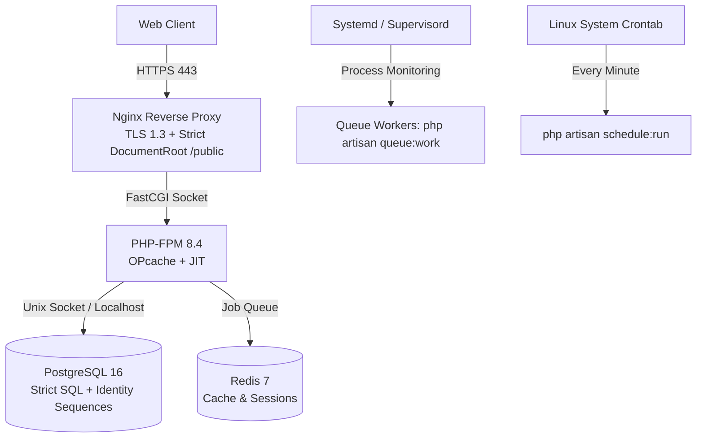

# 08. Security Findings, Operational Vulnerabilities, and Deployment Risks

**Project:** `innova-web` (INNOVA Computers BD / ICBD)  
**Audit Target:** Production Security Hardening & VPS Deployment  
**Audit Date:** October 2026  
**Status:** Read-Only Audit (Phase 0) — Secret values strictly redacted  
**Auditor:** Senior Security Architect & Infrastructure Specialist  

---

## 1. Executive Summary

This report catalogues the security posture, operational vulnerabilities, and deployment readiness of `innova-web`. The audit identified **twelve critical and high-severity security findings** that must be addressed prior to deploying on a production VPS.

Among the most severe discoveries: a **1.4 MB unencrypted production database dump is committed directly inside the Blade views directory**, **live production database credentials were hardcoded into `config/database.php`**, **arbitrary file uploads in `SettingController` enable Remote Code Execution (RCE)**, **brute-force rate limiting is disabled on `/admin/login`**, and **48 out of 49 Admin Controllers lack authorization checks**.

---

## 2. Vulnerability Catalog and Risk Register

| Finding ID | Vulnerability Title | Severity (CVSS v3.1) | Impacted Component | Verification Status |
|---|---|---|---|---|
| **SEC-01** | Production Database Dump Exposed in Views | **Critical (9.8)** | `resources/views/admin/report/innovacomputer_pay.sql` | **Confirmed** |
| **SEC-02** | Hardcoded Live DB Credentials in Default Config | **Critical (9.1)** | `config/database.php:51-53` | **Confirmed** |
| **SEC-03** | Unrestricted Arbitrary File Upload (RCE) | **High (8.8)** | `SettingController.php:35-50` / `UploadAble.php:27` | **Confirmed** |
| **SEC-04** | Remote Code Execution in UniSharp Filemanager | **High (8.6)** | `unisharp/laravel-filemanager` (`CVE-2024-21546`) | **Confirmed** |
| **SEC-05** | Missing RBAC Authorization on 48 Admin Controllers | **High (8.5)** | `app/Http/Controllers/Admin/*` | **Confirmed** |
| **SEC-06** | Missing Brute-Force Rate Limiting on Admin Login | **High (7.5)** | `Admin/LoginController.php:43-56` | **Confirmed** |
| **SEC-07** | Shared Hosting Root Directory Exposure | **High (7.5)** | Root `index.php` and dual asset folders | **Confirmed** |
| **SEC-08** | Payment Replay and Duplicate Callback Hole | **High (7.4)** | `BkashController.php:169-186` | **Confirmed** |
| **SEC-09** | Server Paths Leaked in Committed Error Logs | **Medium (5.3)** | `config/error_log` | **Confirmed** |
| **SEC-10** | Disabled SSL Peer Verification in SMS cURL | **Medium (5.3)** | `SMSController.php:32` | **Confirmed** |
| **SEC-11** | State Mutations & Dispatches via HTTP GET | **Medium (5.3)** | `routes/admin.php:37, 196-200` | **Confirmed** |
| **SEC-12** | Undefined Route Name in Exception Handler | **Medium (4.3)** | `app/Exceptions/Handler.php:78` | **Confirmed** |

---

## 3. Deep-Dive Security Findings

### 3.1 SEC-01: Production Database Dump Committed in Views Directory
- **Severity:** Critical (CVSS: 9.8)
- **Location:** [`resources/views/admin/report/innovacomputer_pay.sql`](file:///c:/wamp64/www/innova-web/resources/views/admin/report/innovacomputer_pay.sql)
- **Observed Behavior:** A 1.4 MB plain-text MySQL database dump dated February 21, 2024, is stored directly inside the Blade view tree. It contains complete schemas, Bcrypt password hashes of admin users, student personal records, phone numbers, addresses, and payment transaction histories.
- **Why It Matters:** Anyone with read access to the repository, or any vulnerability allowing local file inclusion (LFI) or directory traversal, can exfiltrate the entire historical student and financial database.
- **Remediation Plan:**
  1. Delete `innovacomputer_pay.sql` from the filesystem immediately.
  2. Use `git filter-repo` or BFG Repo-Cleaner to permanently purge the file from Git commit history.
  3. Ensure all admin users in that dump have updated their passwords.

---

### 3.2 SEC-02: Hardcoded Production Credentials in Default Configuration
- **Severity:** Critical (CVSS: 9.1)
- **Location:** [`config/database.php:51-53`](file:///c:/wamp64/www/innova-web/config/database.php#L51-L53)
- **Observed Code:**
  ```php
  'database' => env('DB_DATABASE', 'satebwwt_icbdpayments'),
  'username' => env('DB_USERNAME', 'satebwwt_icbdpayments'),
  'password' => env('DB_PASSWORD', '[REDACTED_LIVE_PASSWORD]'),
  ```
- **Why It Matters:** If `.env` is absent, improperly loaded, or if the application is run in an unconfigured staging environment, Laravel falls back to connecting to the production database using hardcoded credentials. Furthermore, committed credentials are permanently recorded in Git version history.
- **Remediation Plan:**
  1. Replace hardcoded default strings with generic placeholders (`'forge'`, `''`).
  2. Immediately rotate the production MySQL database password at the hosting/database level.

---

### 3.3 SEC-03: Unrestricted Arbitrary File Upload (Remote Code Execution)
- **Severity:** High (CVSS: 8.8)
- **Location:** [`app/Http/Controllers/Admin/SettingController.php:35-50`](file:///c:/wamp64/www/innova-web/app/Http/Controllers/Admin/SettingController.php#L35-L50) and [`app/Traits/UploadAble.php:27`](file:///c:/wamp64/www/innova-web/app/Traits/UploadAble.php#L27)
- **Observed Code:**
  ```php
  // In SettingController:
  if ($request->has('site_logo') && ($request->file('site_logo') instanceof UploadedFile)) {
      $logo = $this->uploadOne($request->file('site_logo'), 'img');
      Setting::set('site_logo', $logo);
  }

  // In UploadAble trait:
  return $file->storeAs($folder, $name . "." . $file->getClientOriginalExtension(), $disk);
  ```
- **Why It Matters:**
  1. There is **zero validation** on file size, MIME type, or extension in `SettingController`.
  2. `getClientOriginalExtension()` trusts the extension supplied by the HTTP client header.
  3. An authenticated administrator (or an attacker exploiting a CSRF flaw) can upload a file named `exploit.php`. It is saved into `public/storage/img/exploit.php`.
  4. Accessing `https://example.com/storage/img/exploit.php` executes arbitrary PHP code with the permissions of the web server (`www-data`).
- **Remediation Plan:**
  Implement strict validation rules:
  ```php
  $request->validate([
      'site_logo' => 'nullable|file|image|mimes:jpeg,png,webp,svg|max:2048',
      'site_favicon' => 'nullable|file|mimes:ico,png|max:512',
  ]);
  ```

---

### 3.4 SEC-05: Missing RBAC Authorization Checks Across 48 Admin Controllers
- **Severity:** High (CVSS: 8.5)
- **Location:** [`app/Http/Controllers/Admin/*`](file:///c:/wamp64/www/innova-web/app/Http/Controllers/Admin/) and [`routes/admin.php`](file:///c:/wamp64/www/innova-web/routes/admin.php)
- **Observed Behavior:**
  1. Spatie Laravel Permission is installed, but in `routes/admin.php`, the admin route group only applies `auth:admin`.
  2. Out of 49 Admin Controllers, **only `RoleController.php` checks permissions**:
     ```php
     $this->middleware('permission:role-list|role-create...', ['only' => ['index','store']]);
     ```
  3. In `EmiInstallmentController.php:17`, the authorization middleware was commented out:
     ```php
     // $this->middleware(['auth:admin', 'role:superadmin|admin|hr']);
     ```
  4. The other 47 controllers (Managing Students, Fees, Bank Loans, Expenses, Incomes, Certificates, and Application Settings) have **zero permission checks**.
- **Why It Matters:** Any user with an active admin account (regardless of whether their assigned role is "Teacher", "Staff", or "Data Entry") can access, edit, and delete all corporate finances, bank loan records, system settings, and other admin user accounts.
- **Remediation Plan:** Systematically assign Spatie permission middleware to route groups or controller constructors across all admin modules during the Laravel 13 upgrade.

---

### 3.5 SEC-06: Disabled Rate Limiting / Brute-Force Protection on Admin Login
- **Severity:** High (CVSS: 7.5)
- **Location:** [`app/Http/Controllers/Admin/LoginController.php:43-56`](file:///c:/wamp64/www/innova-web/app/Http/Controllers/Admin/LoginController.php#L43-L56)
- **Observed Code:**
  ```php
  public function login(Request $request) {
      $this->validate($request, [
          'email' => 'required|email',
          'password' => 'required|min:6'
      ]);
      if (Auth::guard('admin')->attempt([
          'email' => $request->email,
          'password' => $request->password
      ], $request->get('remember'))) {
          return redirect()->intended(route('admin.dashboard'));
      }
      return back()->withInput($request->only('email', 'remember'));
  }
  ```
- **Observed Behavior:** The controller includes `use AuthenticatesUsers;`, but explicitly overrides the `login()` method without invoking `hasTooManyLoginAttempts($request)`, `incrementLoginAttempts($request)`, or `sendLockoutResponse($request)`.
- **Why It Matters:** An attacker can conduct unlimited automated credential-stuffing or dictionary attacks against the `/admin/login` endpoint without encountering IP lockout or delay throttles.
- **Remediation Plan:** Restore `ThrottlesLogins` trait usage or attach Laravel's native route rate limiter:
  ```php
  Route::post('login', 'Admin\LoginController@login')
      ->middleware('throttle:5,1')
      ->name('admin.login.post');
  ```

---

### 3.6 SEC-11: State Mutations and Dangerous Actions via HTTP GET
- **Severity:** Medium (CVSS: 5.3)
- **Locations:**
  - [`routes/admin.php:31-48`](file:///c:/wamp64/www/innova-web/routes/admin.php#L31-L48):
    ```php
    Route::get('/optimize', function () { Artisan::call('optimize:clear'); });
    Route::get('/configcatche', function () { Artisan::call('config:cache'); });
    Route::get('/cacheclear', function () { Artisan::call('cache:clear'); });
    ```
  - [`routes/admin.php:196-200`](file:///c:/wamp64/www/innova-web/routes/admin.php#L196):
    ```php
    Route::get('/{id}/todaypostpond', 'Admin\SMSController@todayPostpond');
    Route::get('/{id}/duesms', 'Admin\SMSController@dueSMS');
    ```
- **Why It Matters:** HTTP GET requests must be safe and idempotent. Triggering command-line Artisan tasks and real SMS dispatches via GET requests exposes the application to accidental triggering by web crawlers, browser prefetching, and cross-site request forgery (CSRF) via simple `` tag injection.
- **Remediation Plan:** Convert all artisan operations and SMS dispatch endpoints to HTTP `POST` requests protected by CSRF tokens.

---

## 4. VPS Deployment Architecture & Operational Hardening

When deploying Laravel 13 on a self-managed Linux VPS, the following operational requirements must be satisfied:



### 4.1 Deployment Prerequisites & Rollback Readiness
1. **DocumentRoot Enforcement:**
   Configure Nginx server block strictly:
   ```nginx
   root /var/www/innova-web/public;
   index index.php;
   
   location ~ \.(env|git|sql|log)$ {
       deny all;
   }
   ```
2. **Automated PostgreSQL Backups:**
   Install a daily cron script executing `pg_dump`:
   ```bash
   pg_dump -U postgres -d innova_prod -Fc > /var/backups/db/innova_$(date +%Y%m%d_%H%M%S).dump
   ```
3. **Atomic Zero-Downtime Deployments:**
   Utilize Deployer or GitHub Actions symlink structure:
   - `/var/www/innova-web/releases/<timestamp>`
   - `/var/www/innova-web/current -> releases/<timestamp>`
   - `/var/www/innova-web/shared/.env`
   - `/var/www/innova-web/shared/storage`
4. **Instant Rollback Capability:**
   If a deployment fails, reversing the `current` symlink to the previous release restores service in under 2 seconds:
   ```bash
   ln -sfn /var/www/innova-web/releases/<previous_release> /var/www/innova-web/current
   php-fpm8.4 -t && systemctl reload php8.4-fpm
   ```
