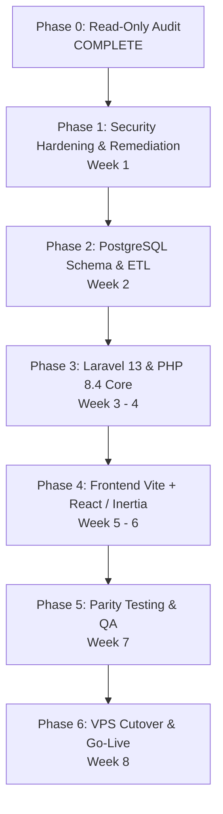

# 09. Incremental Upgrade Roadmap and Migration Blueprint

**Project:** `innova-web` (INNOVA Computers BD / ICBD)  
**Migration Path:** Laravel 8 → Laravel 13 \| PHP 8.0 → PHP 8.4 \| MySQL → PostgreSQL \| Blade → React  
**Audit Date:** October 2026  
**Status:** Read-Only Audit (Phase 0)  
**Auditor:** Senior Laravel Migration Architect & Database Migration Specialist  

---

## 1. Executive Strategy Evaluation

Two distinct methodologies exist for migrating this application to **Laravel 13 + PHP 8.4**:

### Option 1: Sequential In-Place Step Upgrade (8 → 9 → 10 → 11 → 12 → 13)
- **Workflow:** Incrementally update `composer.json` through each major version, run `composer update`, update deprecated method calls, resolve third-party package conflicts at each step, and manually adapt skeletons.
- **Risks:** Extreme dependency solver hell across 5 major version boundaries; legacy files (`app/Http/Kernel.php`, `app/Exceptions/Handler.php`, root `index.php`) remain as technical debt; estimated 50–70 hours of troubleshooting package conflicts.

### Option 2: Clean-Slate Skeleton Re-Platforming to Laravel 13 (Recommended)
- **Workflow:** Initialize a fresh, pristine Laravel 13 application with native PHP 8.4 support and Vite. Systematically port over cleaned database migrations, Eloquent models, repositories, business controllers, and business services. Configure modern `bootstrap/app.php` routing and middleware from day one.
- **Benefits:** Completely bypasses intermediate Composer version conflicts; cleanly eliminates all legacy cPanel shared-hosting cruft; establishes a modern test-driven architecture; estimated 30–40 hours.

---

## 2. Six-Phase Migration Blueprint



---

## 3. Phase-by-Phase Implementation Specifications

### Phase 0: Audit & Baseline Freeze (Current Phase)
- [x] Read-only audit across environment, composer dependencies, PHP 8.4, Laravel 13, PostgreSQL, frontend, workflows, and security.
- [x] Generate 10 comprehensive audit documentation files under `docs/laravel13-upgrade-audit/`.
- [x] Establish baseline inventory of tables (49), controllers (76), models (49), and routes (466).
- [x] **STOP POINT REACHED:** No code or database altered.

---

### Phase 1: Security Hardening & Repository Remediation (Week 1)
*Goal: Remove committed secrets, patch active vulnerabilities, and prepare repository for migration.*

1. **Purge Leaked Assets from Git History:**
   - Remove `resources/views/admin/report/innovacomputer_pay.sql` using `git filter-repo`.
   - Remove `config/error_log` and add `error_log` to `.gitignore`.
2. **Rotate Exposed Credentials:**
   - Rotate production MySQL database password.
   - Rotate bKash merchant API credentials (`BKASH_CHECKOUT_APP_KEY`, `APP_SECRET`, `PASSWORD`).
   - Rotate Elitbuzz SMS gateway API credentials.
3. **Fix Fragile `env()` Calls in Controllers:**
   - Move all external service configurations into `config/services.php`:
     ```php
     'bkash' => [
         'app_key' => env('BKASH_CHECKOUT_APP_KEY'),
         'app_secret' => env('BKASH_CHECKOUT_APP_SECRET'),
         'username' => env('BKASH_CHECKOUT_USER_NAME'),
         'password' => env('BKASH_CHECKOUT_PASSWORD'),
     ],
     'sms' => [
         'url' => env('SMS_URL'),
         'api_key' => env('SMS_API_KEY'),
         'sender_id' => env('SMS_SENDER_ID'),
     ],
     ```
   - Update `BkashController`, `SMSController`, and `FeesTransectionsController` to use `config('services.bkash.*')` and `config('services.sms.*')`.
4. **Harden File Upload Validation:**
   - Add strict image and MIME validation in `SettingController` to eliminate RCE vulnerability.

---

### Phase 2: PostgreSQL Schema Generation and Data ETL Pipeline (Week 2)
*Goal: Reconstruct broken migrations, build complete PostgreSQL schema, and create data transfer script.*

1. **Reconstruct 5 Missing Migrations:**
   - Reverse-engineer proper migration files for `bank_loans`, `emi_installments`, `investment_withdraws`, `dividend_withdraws`, and `certificate_icbds`.
2. **Resolve Migration Class and Table Collisions:**
   - Rename academic `sessions` table and model to `academic_sessions`.
   - Consolidate duplicate `asset_courses` and `asset_students` migrations into clean anonymous classes.
3. **Standardize Financial Data Types:**
   - Define all monetary columns in the migration suite as `$table->decimal('amount', 12, 2)->default(0.00)` instead of `string()`.
   - Preserve `students.IsActive` as `$table->smallInteger('IsActive')->default(1)` to retain 5 academic status states.
4. **Develop ETL Data Sanitization Script:**
   - Create a CLI command (`php artisan migrate:mysql-to-pgsql`) extracting data from MySQL, sanitizing formatted strings (`12,000` → `12000.00`), converting zero dates (`0000-00-00`) to `NULL`, and streaming into PostgreSQL.
5. **Sequence Synchronization:**
   - Execute `SELECT setval(pg_get_serial_sequence(table, 'id'), MAX(id))` for all 49 tables.

---

### Phase 3: Core Application Migration to Laravel 13 & PHP 8.4 (Weeks 3–4)
*Goal: Build the new Laravel 13 backend foundation and port business logic.*

1. **Initialize Fresh Laravel 13 Project:**
   - Provision fresh skeleton using PHP 8.4 and PostgreSQL connection.
2. **Port & Modernize Models (49 Classes):**
   - Replace deprecated `protected $dates = [...]` with `protected function casts(): array`.
   - Add explicit property type declarations and modern relationships.
3. **Modernize HTTP Foundation & Routing in `bootstrap/app.php`:**
   - Register route files (`routes/web.php`, `routes/admin.php`, `routes/console.php`).
   - Configure controller namespace binding or convert routes to `[Controller::class, 'method']`.
   - Configure global middleware, trust proxies, and rate limiters.
   - Port custom exception handlers for Spatie permissions and authentication redirects.
4. **Modernize Package Ecosystem:**
   - Remove `swiftmailer/swiftmailer`, `fideloper/proxy`, `beyondcode/laravel-dump-server`.
   - Upgrade `spatie/laravel-permission` to `^6.0`.
   - Upgrade `intervention/image` to `^3.0` and update `AssetController.php`.
   - Upgrade `barryvdh/laravel-dompdf` to `^3.0`.
   - Replace `fzaninotto/faker` with `fakerphp/faker: ^1.23`.
5. **Fix Workflow Anti-Patterns:**
   - Wrap student admissions in `DB::transaction()` and use DB-generated `id` for SID generation.
   - Add idempotency check in `BkashController@success` to prevent duplicate payment insertion.
   - Convert all dangerous state-changing HTTP GET routes (SMS triggers, artisan calls) to HTTP POST with CSRF tokens.

---

### Phase 4: Frontend Modernization with Vite and React (Weeks 5–6)
*Goal: Replace obsolete Laravel Mix 4 and implement modern React UI.*

1. **Install Tooling:**
   - Install `vite`, `@laravel/vite-plugin`, `@vitejs/plugin-react`, and `tailwindcss`.
   - Install Inertia.js adapter (`inertiajs/inertia-laravel` and `@inertiajs/react`).
2. **Migrate Public Website to React Components:**
   - Convert public pages (Home, About, Contact, Courses, Team, Services, Products) to modern React components with responsive Tailwind CSS.
3. **Migrate Student Portal to React:**
   - Student Dashboard, Profile, Payment History, Online Registration.
4. **Incrementally Port Admin Portal Views:**
   - Prioritize high-traffic modules: Student Admissions, Fee Collections, Daily Reports.
   - Utilize TanStack Table for DataTables replacement and Headless UI for Select2 dropdowns.

---

### Phase 5: Automated Testing, QA Parity & Security Verification (Week 7)
*Goal: Verify 100% functional parity and security compliance.*

1. **Execute Integration Test Suite:**
   - Run tests for Admissions, Payments, bKash callbacks, and Reports against local PostgreSQL.
2. **Financial Ledger Parity Verification:**
   - Run verification queries comparing MySQL totals against PostgreSQL totals for every expense category, income category, and student fee balance. Ensure 100.00% matching amounts.
3. **Security Audit & Automated Scans:**
   - Run `composer audit` and `npm audit` (Target: 0 vulnerabilities).
   - Test rate limiting on `/admin/login` (verify lockout after 5 failed attempts).
   - Test file upload endpoint with `.php` files (verify rejection).

---

### Phase 6: VPS Provisioning, Zero-Downtime Deployment & Cutover (Week 8)
*Goal: Seamless cutover from legacy shared hosting to modern VPS.*

1. **VPS Infrastructure Setup:**
   - Ubuntu 24.04 LTS, Nginx 1.24, PHP-FPM 8.4, PostgreSQL 16, Redis 7, Supervisord.
   - Configure TLS 1.3 certificates via Let's Encrypt / Certbot.
   - Set Nginx document root strictly to `/var/www/innova-web/current/public`.
2. **Dry-Run Data Migration (T - 2 Days):**
   - Execute ETL data transfer against VPS PostgreSQL; verify integrity.
3. **Production Cutover Window (Scheduled Maintenance: ~30 Minutes):**
   - Place legacy application in maintenance mode (`php artisan down`).
   - Run final incremental delta ETL data synchronization from MySQL to PostgreSQL.
   - Run post-migration sequence alignment script.
   - Update DNS records (`A` / `AAAA`) to point to the new VPS IP.
   - Verify live SSL, bKash checkout, and admin login on new server.
   - Disable maintenance mode.

---

## 4. Rollback and Disaster Contingency Plan

If critical anomalies or payment failures occur during the cutover window:

```
[Trigger Condition: Unresolvable Payment or Data Integrity Failure]
  │
  ├── 1. Revert DNS A Records back to the legacy shared hosting IP (TTL set to 300s).
  ├── 2. Disable maintenance mode on legacy application (php artisan up).
  ├── 3. If any payments occurred on the new system during testing, export 
  │      new fees_transections records and import into legacy MySQL.
  └── 4. Conduct Root Cause Analysis (RCA) in staging environment before re-attempting.
```
