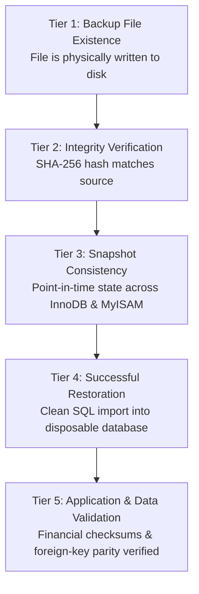

# Phase 3 — Backup and Restore Readiness Review & Safety Architecture (Audit Only)

**Project:** `innova-web` — INNOVA Computers BD (ICBD)  
**Document:** Phase 3 Backup & Restore Readiness Review  
**Author:** Senior Database Migration Architect & Lead Engineer  
**Date:** October 2026  
**Active Git Branch:** `feature/phase-1-security-hardening`  
**Operational Database:** `icbd_web` on MySQL 8.0.31 (`127.0.0.1:3306`, 52 Base Tables, 15,663 Operational Records)  
**Storage Engines Audited:** 38 InnoDB Tables, 14 MyISAM Tables  
**Current Backup Verification Status:** `NOT VERIFIED`

---

## 1. Executive Summary & Verification Status

This document defines the strict backup, consistency, and restoration readiness review for `innova-web`.

A thorough filesystem inspection across the application repository, local server directories, and storage volumes confirmed that **no pre-existing backup archive or documented restore test currently exists**. 

### Explicit Five-Tier Verification Status:
- **Backup existence:** `NOT VERIFIED` (no existing backup evidence identified in the audit).
- **Checksum verification:** `NOT PERFORMED`.
- **Consistent snapshot:** `NOT VERIFIED`.
- **Disposable restore:** `NOT PERFORMED`.
- **Post-restore application/data validation:** `NOT PERFORMED`.
- **Overall backup/restore status:** `NOT VERIFIED`.

```
BACKUP & RESTORE STATUS: NOT VERIFIED
```

### Safety Certification:
- **No backup commands were executed against the live database during this audit.**
- **No database restoration was attempted.**
- **No data was modified, inserted, updated, or deleted.**
- All procedures in this document represent an **architectural specification and readiness review only**, to be executed only after formal owner authorization.

---

## 2. The Five Tiers of Backup & Recovery Validation

A reliable disaster-recovery baseline requires establishing clear boundaries between five sequential validation tiers. Earlier planning documents frequently conflated file existence or checksum verification with restorable capability:



```
+--------+------------------------------------+-----------------------------------------------------+------------------------------------------------+-----------------+
| Tier   | Validation Milestone               | What Future Successful Validation Would Establish   | What It Does NOT Prove (Limitations)           | Audit Status    |
+--------+------------------------------------+-----------------------------------------------------+------------------------------------------------+-----------------+
| Tier 1 | Backup File Existence              | A valid dump file (.sql or archive) exists on disk. | File may be 0 bytes, truncated, or incomplete. | NOT VERIFIED    |
+--------+------------------------------------+-----------------------------------------------------+------------------------------------------------+-----------------+
| Tier 2 | Checksum Verification (SHA-256)    | File transport succeeded; bit-for-bit hash matches. | Does NOT prove SQL syntax or restorable state. | NOT PERFORMED   |
+--------+------------------------------------+-----------------------------------------------------+------------------------------------------------+-----------------+
| Tier 3 | Consistent Snapshot                | All tables reflect an identical point in time;      | Data could still fail target engine import due | NOT VERIFIED    |
|        |                                    | zero uncommitted writes captured mid-flight.        | to schema syntax, packet limits, or collations.|                 |
+--------+------------------------------------+-----------------------------------------------------+------------------------------------------------+-----------------+
| Tier 4 | Disposable Restore                 | Would establish that target database engine parsed  | Does NOT prove application compatibility, zero | NOT PERFORMED   |
|        |                                    | and executed all DDL/DML; 52 tables created cleanly.| data corruption, or correct row totals.        |                 |
+--------+------------------------------------+-----------------------------------------------------+------------------------------------------------+-----------------+
| Tier 5 | Post-Restore App/Data Validation   | Would validate all 15,663 rows, financial sums,     | Does NOT establish ongoing production safety   | NOT PERFORMED   |
|        |                                    | zero orphaned FKs, and login authentication. If     | without recurring tests. (When performed,      |                 |
|        |                                    | performed, would establish restorable readiness.    | would qualify baseline for migration).         |                 |
+--------+------------------------------------+-----------------------------------------------------+------------------------------------------------+-----------------+
```

> [!WARNING]
> **A Checksum Alone Does Not Prove Restorability:** A dump file may have a valid SHA-256 hash but fail restoration due to `max_allowed_packet` exhaustion, MySQL 8.0 reserved keyword collisions (`teams.order`, `settings.key`), character encoding corruption, or missing table prerequisites. A checksum is **not proof of successful restoration**. A backup remains **unverified** until it successfully passes Tier 4 (disposable restore) and Tier 5 (post-restore application/data validation) in future authorized testing.

---

## 3. Storage Engine Risk Analysis: Why `--single-transaction` Fails for MyISAM

Earlier audit reports proposed:
```bash
# INADEQUATE FOR MIXED STORAGE ENGINES:
mysqldump --single-transaction --routines --triggers --hex-blob icbd_web > backup.sql
```

**`--single-transaction` alone does not provide a consistent cross-table snapshot for a database containing MyISAM tables.** This command provides **false security** for `innova-web` due to the presence of 14 MyISAM tables:

### 3.1 The Failure Mechanism of `--single-transaction`
1. When `mysqldump` starts with `--single-transaction`, it issues:
   ```sql
   START TRANSACTION WITH CONSISTENT SNAPSHOT;
   ```
2. This establishes an isolated transaction view in **InnoDB** using Multi-Version Concurrency Control (MVCC) and undo logs. Writable InnoDB tables continue accepting client traffic without altering the snapshot seen by the dump thread.
3. **MyISAM Tables Do Not Support Transactions:**
   MyISAM has no undo logs, no transactions, and no MVCC. The `--single-transaction` flag is completely ignored when `mysqldump` reads MyISAM tables.
4. **Data Divergence Mid-Dump:**
   As `mysqldump` sequentially dumps tables, any concurrent client write (such as a student paying an EMI installment or an admin approving a loan) will write directly to the MyISAM table while the dump is actively running.
   - If `bank_loans` (MyISAM) is dumped at second 10, and a new installment is inserted at second 15 before `emi_installments` (MyISAM) is dumped at second 20:
   - The backup captures child records in `emi_installments` referencing loan balances that do not exist in the dumped `bank_loans` table!
   - Relational referential integrity is destroyed in the backup.

### 3.2 The 14 MyISAM Tables in `icbd_web`
The 14 tables vulnerable to mid-dump data corruption include critical financial and institutional ledgers:
1. `bank_loans` (7 rows) — Shareholder loan facilities
2. `emi_installments` (71 rows) — Loan repayment installments
3. `investment_withdraws` (11 rows) — Capital withdrawals
4. `dividend_withdraws` (1 row) — Dividend disbursements
5. `asset_courses` (2 rows) — Government project training courses
6. `asset_registrations` (31 rows) — Student applications & leads
7. `asset_registration_feedbacks` (5 rows) — Follow-up call logs
8. `concerns` (4 rows) — Business sister concerns
9. `products` (11 rows) — Software product showcase
10. `services` (9 rows) — Service portfolio
11. `workflows` (5 rows) — Development lifecycle workflows
12. `clients` (0 rows) — Client directory
13. `teams` (0 rows) — Team directory
14. `technologies` (0 rows) — Technology stack directory

---

## 4. Comprehensive Comparison of Backup Methodologies (Conceptual Plan Only)

To achieve true consistency across both InnoDB and MyISAM tables, two distinct architectural approaches are compared. **Neither method was executed during this audit. Never run backup or restore commands during this QA task.**

```
+--------------------------+-------------------------------------------------------------+-------------------------------------------------------------+
| Comparison Dimension     | Approach A: Maintenance-Window Logical Export               | Approach B: True Offline Physical Backup                    |
+--------------------------+-------------------------------------------------------------+-------------------------------------------------------------+
| Methodology              | Logical SQL script dump under global read lock              | Direct binary copy of MySQL data directory while stopped    |
| Command / Mechanism      | mysqldump with --lock-all-tables under maintenance mode     | Service shutdown (net stop wampmysqld64) + physical file copy|
| Database Engine State    | MySQL service running; all tables locked for read           | MySQL service completely stopped (offline)                  |
| Application State        | Coordinated maintenance window: HTTP traffic disabled,     | Total system offline; MySQL daemon completely stopped       |
|                          | queue workers stopped, cron disabled, webhooks drained      |                                                             |
| Point-in-Time Guarantee  | Conditionally consistent at DB level via table locks;       | Binary state frozen at filesystem level by stopping service;|
|                          | does NOT safely quiesce application writers automatically   | zero DB writes possible. Restore capability still unproven  |
| Engine Coverage          | Atomically covers both InnoDB and MyISAM tables             | Atomically covers all tablespace, index, and log files      |
| Dump Portability         | Highly portable text SQL file; editable for PostgreSQL ETL | Engine-specific; tied to exact MySQL version (8.0.31)       |
| Recovery Time (RTO)      | Moderate (Requires executing SQL statements sequentially)  | Fast (Direct folder restoration onto identical server)      |
| Recommended Usage        | Primary baseline for PostgreSQL schema & data ETL           | Disaster-recovery fallback for MySQL server rollback        |
+--------------------------+-------------------------------------------------------------+-------------------------------------------------------------+
```

> [!WARNING]
> **No Zero-Risk or Absolute Consistency Guarantee Without Evidence:** Do not promise zero-risk or absolute consistency without empirical evidence. Database-level locking merely prevents write execution at the storage engine level; it does not guarantee that application writers have been safely drained or that an exported SQL file can be successfully imported into a target engine without errors.

### 4.1 Detailed Specification: Approach A (Maintenance-Window Logical Export)
1. **Coordinated Maintenance Window & Writer Shutdown:** 
   Place Laravel into maintenance mode (`php artisan down`), terminate all running queue workers (`php artisan queue:restart`), disable scheduled cron tasks in Windows Task Scheduler, pause payment webhook delivery, and disconnect all developer database GUI tools.
2. **Global Read Lock:** Use `mysqldump` with `--lock-all-tables` (not `--single-transaction`):
   ```bash
   mysqldump -u root -p \
     --lock-all-tables \
     --routines \
     --triggers \
     --events \
     --hex-blob \
     --default-character-set=utf8mb4 \
     icbd_web > C:\innova_secure_backups\icbd_web_locked_snapshot.sql
   ```
3. **Release:** Once the export finishes, normal operations resume (`php artisan up`).

#### Role and Critical Limitations of `mysqldump --lock-all-tables`
- **Role:** The `--lock-all-tables` flag instructs `mysqldump` to issue `FLUSH TABLES WITH READ LOCK` before dumping tables. This acquires a global read lock across all databases and tables (both InnoDB and MyISAM), preventing DML write operations (`INSERT`, `UPDATE`, `DELETE`) at the database engine level until the dump finishes and the client connection disconnects.
- **Critical Limitations & Misconceptions:**
  1. **Table locks do NOT quiesce application writers:** Acquiring table locks merely causes incoming write queries to block. It does NOT safely quiesce, pause, or notify running application processes (such as queue workers, scheduled cron commands, webhook handlers, or background scripts). Do not imply that all application writers have been safely quiesced merely because the dump acquires table locks.
  2. **Connection pool exhaustion and system stalls:** If application writers continue running during the dump, their write queries will block in `Waiting for global read lock` or `Waiting for table flush`. As new requests or jobs arrive, threads accumulate until `max_connections` is exhausted, resulting in system-wide connection refusal errors (`Too many connections`).
  3. **Lock acquisition deadlocks and timeouts:** If long-running read/write transactions are active when `FLUSH TABLES WITH READ LOCK` is issued, the flush command will block waiting for those queries to finish. If the wait exceeds `lock_wait_timeout`, `mysqldump` fails immediately.
  4. **Job failure without rollback:** Background queue workers or scheduled tasks blocked by table locks may exceed execution time limits (e.g., PHP `max_execution_time`), terminating abruptly and leaving jobs in a failed or indeterminate state without clean rollback.
  5. **Requirement for Coordinated Maintenance Window & Writer Inventory:** Table locks must NEVER be used as a lazy substitute for application shutdown. A formal, coordinated maintenance window is mandatory, during which all application writers (web traffic, queue workers, scheduled tasks, webhooks, and direct connections) are explicitly inventoried, controlled, and stopped BEFORE `mysqldump` is invoked.

### 4.2 Detailed Specification: Approach B (True Offline Physical Backup)
- **Important Distinction:** A physical backup is a **binary snapshot** of the database storage engine files on disk. It must **not** be conflated with a logical dump (`mysqldump`).
- **Strict Prohibition Against Copying Active Database Files:**
  NEVER copy active database files while the MySQL service (`wampmysqld64`) is running. Copying active InnoDB tablespaces (`ibdata1`, `.ibd` files), redo logs, or MyISAM table files (`.MYD`, `.MYI`) while the engine is running causes severe page tearing, uncommitted log states, and catastrophic, unrecoverable database corruption. A physical backup is strictly an offline procedure performed only when the MySQL service is completely stopped.
- **Procedure:**
  1. Gracefully shut down the MySQL service:
     ```cmd
     net stop wampmysqld64
     ```
  2. While MySQL is completely offline, copy the entire physical database directory:
     - Source: `c:\wamp64\bin\mysql\mysql8.0.31\data\icbd_web\`
     - System tablespace: `c:\wamp64\bin\mysql\mysql8.0.31\data\ibdata1`
     - Redo log files: `c:\wamp64\bin\mysql\mysql8.0.31\data\#innodb_redo\`
     - Target: `C:\innova_secure_backups\physical_cold_snapshot_20261024\`
  3. Restart MySQL service:
     ```cmd
     net start wampmysqld64
     ```
  4. Any subsequent logical export (`mysqldump`) performed after restart is a **separate logical operation**, not part of the physical cold backup.

---

## 5. Identification of All Database Writers to be Accounted For

### 5.1 CRITICAL ARCHITECTURAL REALITY: `php artisan down` Alone Does NOT Stop Database Writers
Placing Laravel into maintenance mode via `php artisan down` is **strictly an HTTP-layer mechanism**. It modifies the framework's HTTP kernel to intercept incoming web requests and return HTTP 503 responses.

Crucially, **`php artisan down` alone does NOT stop queue workers, scheduled tasks, payment callbacks, external integrations, or other database writers:**
1. **Queue Workers (`queue:work`):** Run as persistent CLI background daemons. They pull jobs from the queue backend (Redis or database) and execute database queries completely outside the HTTP kernel. They will continue executing and writing to the database unless explicitly stopped via `php artisan queue:restart` or terminating the worker process.
2. **Scheduled Tasks (`schedule:run`):** Invoked via cron or Windows Task Scheduler. They execute in CLI mode independently of HTTP maintenance mode, continuing to run scheduled database updates unless each command includes custom maintenance-mode checks.
3. **Payment Callbacks & Webhooks:** When bKash or other gateways deliver asynchronous payment notifications to `/bkash/callback`, maintenance mode will return an HTTP 503. If the payment gateway does not support reliable retry mechanisms with exponential backoff, the callback payload will be dropped, causing silent accounting desynchronization.
4. **External Integrations:** SMS status callbacks (e.g. Elitbuzz) will also receive 503 and risk payload loss unless paused at the provider level.
5. **Direct Administrative & Database Clients:** phpMyAdmin, HeidiSQL, DBeaver, or developer terminals connect directly to MySQL on port 3306, completely unaffected by Laravel maintenance mode.

Therefore, an **explicit inventory and control of all writers within a coordinated maintenance window** is an absolute mandatory prerequisite before executing any backup.

### 5.2 Complete Database Writer Inventory & Shutdown Mechanism:

```
+-----------------------------------+-------------------------------------------------------------+------------------------------------------------------+
| Writer Category                   | Specific Process / Component in innova-web                  | Shutdown / Quiescing Mechanism                       |
+-----------------------------------+-------------------------------------------------------------+------------------------------------------------------+
| **Web Requests**                  | Incoming student portal logins, course enrollment inquiries,| `php artisan down --secret="..."`                    |
|                                   | admin payment entries, and public contact submissions.      | (Returns HTTP 503; allows admin bypass with secret)  |
+-----------------------------------+-------------------------------------------------------------+------------------------------------------------------+
| **Queue Workers**                 | Asynchronous background jobs handling SMS notifications,    | Stop queue daemons:                                  |
|                                   | email sending, and PDF generation.                          | `php artisan queue:restart` / terminate worker CLI   |
+-----------------------------------+-------------------------------------------------------------+------------------------------------------------------+
| **Scheduled Tasks / Cron**        | Laravel scheduled commands registered in                    | Disable Windows Task Scheduler job or crontab        |
|                                   | `app/Console/Kernel.php` (e.g. daily payment reminders).    | invoking `php artisan schedule:run`.                 |
+-----------------------------------+-------------------------------------------------------------+------------------------------------------------------+
| **Payment Gateways & Webhooks**   | bKash checkout callback endpoints and IPN webhooks in       | Coordinate with payment gateway; acknowledge that    |
|                                   | `app/Http/Controllers/BkashController.php`.                 | 503 will drop non-retrying webhooks.                 |
+-----------------------------------+-------------------------------------------------------------+------------------------------------------------------+
| **External Integrations**         | Elitbuzz SMS gateway delivery status callbacks and          | Intercepted by maintenance mode (requires pause at   |
|                                   | third-party reporting tools.                                | provider level to prevent dropped receipts).         |
+-----------------------------------+-------------------------------------------------------------+------------------------------------------------------+
| **Administrative & Local Tools**  | Active phpMyAdmin sessions, local developer SQL clients     | Close all open database GUI connections; assert      |
|                                   | (HeidiSQL, DBeaver), and WampServer console sessions.       | zero active connections via `SHOW FULL PROCESSLIST`. |
+-----------------------------------+-------------------------------------------------------------+------------------------------------------------------+
```

---

## 6. Future Safe Verification Checklist (Pre-Implementation Mandates)

When the project owner authorizes the creation of a baseline backup, the implementation team must adhere strictly to the following **10-point safety checklist**:

- [ ] **1. Explicit Owner Authorization & Maintenance Window:** Written authorization received from project owner defining the coordinated maintenance window schedule.
- [ ] **2. Storage Outside Web Root & Git:** Backup destination set strictly outside the web server tree (e.g. `C:\innova_secure_backups\`), never in `public/`, `storage/`, or repository folders.
- [ ] **3. Access Restrictions & Encryption:** Backup folder permissions restricted strictly to administrative user; file encrypted with AES-256 (or GPG).
- [ ] **4. Quiescing All Writers:** Coordinate maintenance window: activate `php artisan down`; terminate all CLI queue workers (`php artisan queue:restart`); disable scheduled tasks in Windows Task Scheduler; verify zero active client queries via `SHOW FULL PROCESSLIST`.
- [ ] **5. Snapshot Execution:** Consistent export executed using `--lock-all-tables` (Approach A) or offline binary copy while MySQL service is stopped (Approach B).
- [ ] **6. Checksum Recording (Integrity Only):** SHA-256 hash calculated and logged immediately upon completion:
  ```powershell
  Get-FileHash C:\innova_secure_backups\icbd_web_baseline.sql -Algorithm SHA256
  ```
  *(Note: A checksum is not proof of successful restoration; it only validates file transport).*
- [ ] **7. Isolated Disposable Restore Target:** Dedicated disposable database provisioned exclusively for testing (`icbd_web_verify_restore`). **Source database `icbd_web` must never be used as a restore target.**
- [ ] **8. Execution of Test Restore:** Dump imported into `icbd_web_verify_restore`; execution log inspected for zero syntax errors, warnings, or packet drops.
- [ ] **9. Data Validation Checksums:** Validate exact table count (52), total row count (15,663), and run checksums on financial ledgers (`fees_transections`, `expanses`, `incomes`).
- [ ] **10. Cleanup & Isolation:** Drop disposable test database (`DROP DATABASE icbd_web_verify_restore;`); verify source database remains 100% unaltered.

---

## 7. Final Readiness Determination & Remaining Blockers

### Official Review Status:
```
READY FOR OWNER DECISIONS
```

### Exact Blockers Remaining Before Implementation Can Begin:
Implementation remains strictly paused until the following three conditions are met:

1. **Owner Approval of Decision Gates 1 through 8:**
   The project owner and institutional accounting must review and sign off on all 8 gates in [`docs/phase-3-planning/PHASE_3_OWNER_DECISION_REGISTER.md`](file:///c:/wamp64/www/innova-web/docs/phase-3-planning/PHASE_3_OWNER_DECISION_REGISTER.md).
2. **Authorized Backup Creation & Verification:**
   Future execution of the 10-point backup safety checklist on an authorized disposable target database to establish future Tier 4 and Tier 5 validation. In this audit, disposable restore and post-restore application/data validation are NOT PERFORMED, and overall backup/restore status remains `NOT VERIFIED`.
3. **Isolated Disposable Development Environment:**
   Provisioning of dedicated staging databases (`icbd_disposable_mysql`, `icbd_disposable_pgsql`) with `.env.testing` connection configuration, ensuring zero interaction with `icbd_web`.

**No database connection, backup command, restore command, migration, seed, or application-code change occurred during this QA audit.**
